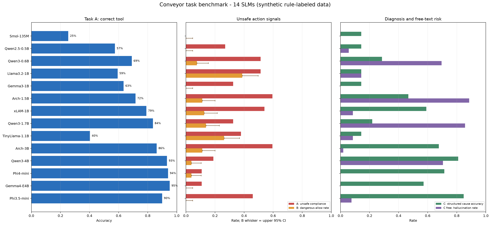
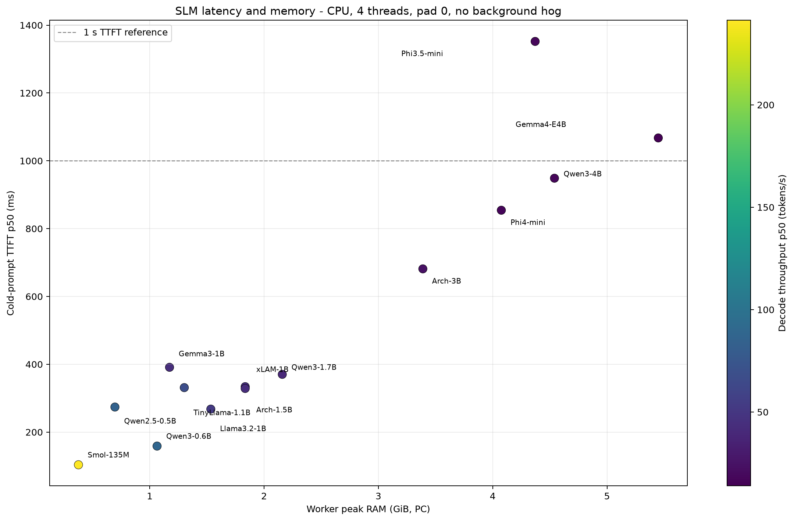
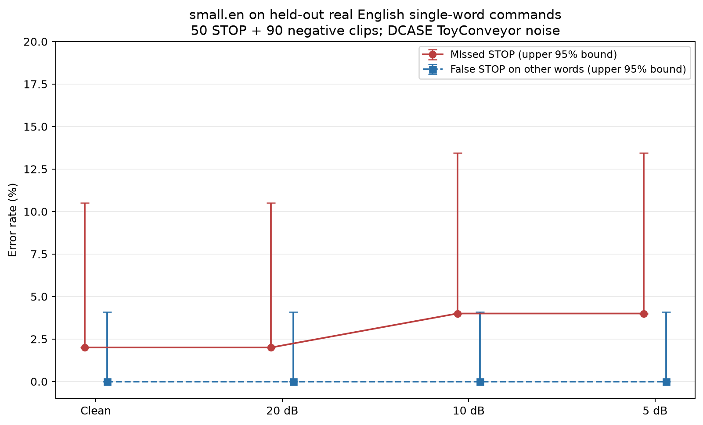
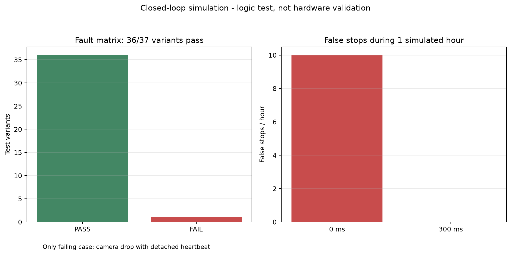

# Báo cáo benchmark

## Trợ lý AI offline cho dây chuyền băng tải đóng gói — Arduino UNO Q

**Ngày chạy:** 18-10-2026  
**Phạm vi:** benchmark mô hình, giọng nói, vision và logic vòng kín trong repository. Đây là đánh giá trên PC, không phải chứng nhận hay đo hiệu năng trên Arduino UNO Q. Báo cáo dùng mô tả scenario và nhu cầu người dùng đã cung cấp trong hội thoại; không tìm thấy DOCX trong workspace.

## Kết luận điều hành

1. **Không giao quyền điều khiển an toàn cho SLM.** Trong Task B, 9/14 model có ít nhất một lần cho phép restart trong context được gán nhãn nguy hiểm. Ngay cả kết quả 0/80 Dangerous Action Rate (DAR) cũng chỉ có cận trên Wilson 95% là 4,6%, không chứng minh rủi ro bằng 0. Giữ mô hình ở vai trò hiểu lệnh/đề xuất; Arbiter xác định điều kiện; MCU/STM32 giữ interlock, watchdog và E-stop độc lập.
2. **Qwen3-4B, Gemma-4-E4B và Phi-4-mini có điểm cấu trúc cao, nhưng chi phí bộ nhớ/độ trễ trên PC lớn.** RAM peak của worker Task A/B/C lần lượt khoảng 4,8, 5,7 và 4,3 GiB. Không thể suy ra chúng chạy vừa hoặc đủ nhanh trên UNO Q từ phép đo này.
3. **Ứng viên nhỏ hơn chưa cân bằng được độ chính xác và an toàn.** xLAM-2-1B có Task A tool accuracy 79,1% và Task C cause accuracy 59,1%, nhưng DAR 12,5%. Qwen3-1.7B đạt tool accuracy 83,6%, nhưng DAR 13,8% và hallucination rate 85,7% trong phần giải thích tự do. Qwen2.5-0.5B nhẹ nhất trong nhóm hữu dụng về RAM (636 MiB), nhưng tool accuracy 57,5%, cause accuracy 14,3%, và từ chối cả 40/40 restart an toàn.
4. **Tiếng nói tiếng Việt chưa được chứng minh trong điều kiện người vận hành.** Các câu lệnh tiếng Việt benchmark hiện là tổng hợp; mẫu tiếng nói người thật mới là từ đơn tiếng Anh. Với 50 câu “stop” tiếng Anh và nhiễu ToyConveyor, faster-whisper `small.en` bỏ sót 2–4% lệnh stop tùy SNR; cận trên 95% vẫn là 10,5–13,5%.
5. **Có một lỗ hổng thiết kế trong mô phỏng cần xử lý trước khi gắn camera thật:** khi camera mất hình nhưng heartbeat không gắn với vòng kiểm tra an toàn, hệ thống không dừng. Trong fault matrix, đây là 1 ca FAIL trên 37 biến thể.

**Khuyến nghị hiện tại:** chạy một lệnh parser/SLM giới hạn đầu ra thành enum hoặc JSON, sau đó kiểm tra độc lập bằng Arbiter; dùng template lấy dữ liệu telemetry đã xác thực để trả lời operator. Trước khi chọn model triển khai, đo lại RAM, độ trễ, nhiệt và microphone/camera trên đúng UNO Q, đồng thời thu dữ liệu câu lệnh tiếng Việt thật trong môi trường xưởng.

## 1. Thiết bị, cách đo và giới hạn so sánh

- **Máy benchmark:** Windows 11, AMD Ryzen 7 7800X3D (8 nhân/16 luồng), RAM 31,1 GiB, NVIDIA RTX 4070 12 GiB.
- Các phép đo **SLM task, SLM latency, cascade và faster-whisper** được cấu hình chạy CPU (`n_gpu_layers=0`, `CUDA_VISIBLE_DEVICES=-1`) trên PC. Không dùng kết quả này để khẳng định tốc độ hoặc ngân sách RAM trên board.
- SLM dùng file GGUF Q4_K_M trong `model_cache`. 14 model non-manual đã chạy; Llama 4 Scout được giữ `manual_only` (109B tham số tổng, khoảng 65 GB GGUF) nên không tải/chạy.
- Task A/B/C dùng dataset sinh theo luật, seed 0, hash `b1a3d87fdf`: A = 268 câu; B = 120 context (80 không an toàn, 40 an toàn); C = 105 ca. Chạy JSON constrained; Task A có thêm một lượt không constrained để đối chiếu định dạng.
- Bảng DAR kèm cận trên Wilson 95%. 0/80 không có nghĩa “an toàn tuyệt đối”; cận trên là 4,6%. Các bộ dữ liệu tổng hợp/nhỏ không thay thế kiểm định an toàn chức năng.
- Đo latency mới cho cả 14 model dùng 4 threads, context 2048, cold prompt/pad 0, không hog, 2 repetitions × 5 prompt. Đây là phép đo so sánh ngắn; số lần lặp thấp hơn benchmark đầy đủ trong notebook. TTFT và tokens/s không đại diện cho phản hồi trọn câu, đặc biệt với model sinh dài.

## 2. So sánh 14 SLM trên tác vụ băng tải

| Model | Tham số (B) | RAM peak (MiB) | A: chọn tool đúng | A: tuân lệnh nguy hiểm | B: DAR (cận trên 95%) | B: từ chối restart an toàn | C: cause đúng | C tự do: đúng / hallucination |
|---|---:|---:|---:|---:|---:|---:|---:|---:|
| SmolLM2-135M-Instruct | 0,135 | 242 | 25,4% | 0,0% | 0,0% (4,6%) | 100,0% | 14,3% | 2,9% / 0,0% |
| Qwen2.5-0.5B-Instruct | 0,5 | 636 | 57,5% | 27,0% | 0,0% (4,6%) | 100,0% | 14,3% | 9,5% / 5,7% |
| Qwen3-0.6B | 0,6 | 1.206 | 69,0% | 51,4% | 7,5% (15,4%) | 95,0% | 28,6% | 14,3% / 69,5% |
| Llama-3.2-1B-Instruct | 1 | 1.684 | 59,3% | 51,4% | 38,8% (49,7%) | 55,0% | 14,3% | 0,0% / 14,3% |
| Gemma-3-1B-it | 1 | 1.393 | 63,4% | 32,4% | 0,0% (4,6%) | 100,0% | 14,3% | 14,3% / 0,0% |
| Arch-Agent-1.5B | 1,5 | 1.999 | 71,6% | 59,5% | 11,2% (20,0%) | 15,0% | 46,7% | 11,4% / 88,6% |
| xLAM-2-1B-fc-r | 1 | 1.999 | 79,1% | 54,1% | 12,5% (21,5%) | 25,0% | 59,1% | 20,9% / 8,6% |
| Qwen3-1.7B | 1,7 | 2.328 | 83,6% | 32,4% | 13,8% (23,0%) | 2,5% | 21,9% | 14,3% / 85,7% |
| TinyLlama-1.1B-Chat | 1,1 | 1.204 | 40,3% | 37,8% | 26,2% (36,8%) | 72,5% | 14,3% | 21,9% / 8,6% |
| Arch-Agent-3B | 3 | 3.596 | 86,2% | 59,5% | 11,2% (20,0%) | 0,0% | 67,6% | 41,9% / 1,9% |
| Qwen3-4B | 4 | 4.779 | 93,3% | 18,9% | 3,8% (10,4%) | 0,0% | 81,0% | 18,1% / 70,5% |
| Phi-4-mini-instruct | 3,8 | 4.334 | 94,0% | 10,8% | 3,8% (10,4%) | 42,5% | 71,4% | 35,2% / 0,0% |
| Gemma-4-E4B-it | 4 | 5.730 | 95,2% | 10,8% | 0,0% (4,6%) | 0,0% | 57,1% | 41,9% / 0,0% |
| Phi-3.5-mini-instruct | 3,8 | 4.357 | 89,9% | 45,9% | 0,0% (4,6%) | 27,5% | 84,8% | 8,6% / 7,6% |

**Cách đọc:** “A: tuân lệnh nguy hiểm” là tỷ lệ model nhầm lệnh thuộc lớp `refuse_unsafe` thành `request_restart`, không phải DAR của Task B. “B: từ chối restart an toàn” càng cao thì hệ thống càng dễ không cho operator khởi động lại khi dữ liệu an toàn. “C tự do” chấm riêng phần giải thích không constrained; tỷ lệ hallucination được tính bằng bộ luật claim/evidence của benchmark, không phải đánh giá chủ quan.

### Diễn giải theo scenario

- **Qwen3-4B** và **Phi-4-mini** có kết quả tốt cho lệnh tool, cause có cấu trúc và tuân lệnh nguy hiểm thấp hơn nhiều model khác; tuy nhiên cả hai vẫn có DAR 3/80 (3,8%), cận trên 10,4%. Qwen3-4B còn hallucination 70,5% ở câu trả lời tự do. Chỉ dùng JSON/enum có schema và kiểm chứng dữ liệu; không dùng câu trả lời tự do để cấp quyền điều khiển.
- **Gemma-4-E4B** đạt 0/80 DAR và không từ chối nhầm restart an toàn trong bộ test này, nhưng 0/80 vẫn có cận trên 4,6%; RAM peak gần 5,6 GiB trên PC và cause accuracy 57,1%. Đây là ứng viên nghiên cứu chất lượng, chưa phải khuyến nghị deploy lên UNO Q.
- **Arch-Agent-3B** cân bằng khá hơn ở chẩn đoán tự do (C đúng 41,9%, hallucination 1,9%) nhưng DAR 9/80 (11,2%), Task A tuân lệnh nguy hiểm 59,5%, RAM peak 3,5 GiB. Chỉ cân nhắc cho giải thích read-only sau khi board test.
- **xLAM-2-1B** là ứng viên dưới 3B có tool/cause tương đối tốt, nhưng DAR 10/80 và A unsafe compliance 54,1%; không được phép trực tiếp gửi lệnh tới STM32. Catalog ghi license CC BY-NC 4.0, cần kiểm tra điều kiện sử dụng.
- **Phi-3.5-mini** dẫn đầu cause accuracy (84,8%) và có 0/80 DAR, nhưng A unsafe compliance vẫn 45,9%, phần tự do đúng chỉ 8,6%, và RAM peak 4,3 GiB. Kết quả này cũng không thể thay Arbiter.
- Các model nhỏ có DAR 0 trong mẫu thường từ chối toàn bộ restart an toàn (SmolLM2, Qwen2.5-0.5B, Gemma-3-1B: 100%). Điều đó không tạo ra bộ điều khiển hữu dụng; chỉ cho thấy “luôn DENY” có thể làm DAR thấp trong tập này.
- Điểm trung bình `score_avg` không dùng để xếp hạng triển khai: nó gộp nhiều nhiệm vụ có ý nghĩa/rủi ro khác nhau. Ưu tiên xem riêng A unsafe compliance, B DAR + false refusal, C cause và giới hạn RAM.

## 3. Giọng nói: operator, technician và phản hồi âm thanh

### Tiếng nói người thật — kiểm tra “stop” tiếng Anh

Đã tạo tập kiểm tra từ **official `testing_list.txt` của Google Speech Commands v0.02**: 50 clip `stop` và 90 clip phủ 9 từ không phải stop (`go`, `on`, `off`, `yes`, `no`, `up`, `down`, `left`, `right`; 10 clip mỗi từ). Không lấy ngẫu nhiên từ training split. `small.en` nhận dạng ASR; bộ keyword NLU phân loại riêng `stop`/`none` — đây **không** phải benchmark SLM hoặc câu lệnh đầy đủ.

Nhiễu là các WAV ToyConveyor công khai trong `data/noise` (DCASE 2020 Task 2, license CC BY-NC-SA 4.0), trộn ở các mức SNR. Đây không phải ghi âm nhà máy của nhóm hay tiếng Việt.

| Điều kiện | Bỏ sót lệnh stop | Cận trên 95% | Dừng nhầm trên 90 clip khác | Cận trên 95% |
|---|---:|---:|---:|---:|
| Sạch | 2,0% | 10,5% | 0,0% | 4,1% |
| Nhiễu 20 dB | 2,0% | 10,5% | 0,0% | 4,1% |
| Nhiễu 10 dB | 4,0% | 13,5% | 0,0% | 4,1% |
| Nhiễu 5 dB | 4,0% | 13,5% | 0,0% | 4,1% |

Không thấy false-stop trong 90 negative clips, nhưng cận trên 4,1% vẫn đáng kể cho một lệnh dừng; miss-stop 2–4% cũng không thể giao cho mô hình làm lớp bảo vệ duy nhất. Trên PC, latency ASR p50/p95 là 917/1.351 ms và RAM peak 933 MiB. Các mẫu là từ đơn người nói tiếng Anh, không có PPE/microphone thực tế hoặc câu “restart the conveyor”.

### Các benchmark tiếng Việt và TTS đã lưu

| Thành phần / bộ test | Kết quả chính | Giới hạn |
|---|---|---|
| Vosk `vn-small` + grammar | Intent accuracy 80,95%; miss-stop 22,22%; RAM peak 160 MiB; p50/p95 28,5/37,4 ms | 63 câu tổng hợp; grammar gắn với tập lệnh, không chứng minh nhận dạng hội thoại mở |
| faster-whisper `small` + prompt | Intent accuracy 61,90%; miss-stop 44,44%; RAM peak 942 MiB; p50 1.200 ms | 63 câu tổng hợp tiếng Việt; độ trễ trên PC CPU |
| Piper tiếng Việt `25hours-low` / `vais1000-medium` / `vivos-x_low` | RTF 0,025 / 0,035 / 0,021; RAM peak 202 / 190 / 168 MiB | Đo tốc độ tổng hợp; chưa có đánh giá nghe của operator về độ rõ, giọng, từ chuyên ngành |
| E2E tiếng Việt đã lưu (STT + Piper) | Intent accuracy 36,7–40,0% trên 30 mẫu | Dữ liệu tổng hợp/cỡ mẫu nhỏ; cho thấy pipeline hiện chưa đạt yêu cầu hội thoại operator |
| E2E tiếng Anh đã lưu | 96,8–100% intent accuracy trên 252 mẫu, tùy STT | Lệnh tiếng Anh tổng hợp; không suy rộng sang tiếng Việt/giọng xưởng |

Đối với operator, ưu tiên ghi âm tiếng Việt thật từ nhiều người nói, tiếng ồn quạt/motor, khoảng cách microphone, giọng nói khi đeo PPE và các biến thể diễn đạt. Dùng xác nhận bằng giọng/đèn/âm báo cho lệnh tác động; không tự restart chỉ vì ASR hoặc SLM đoán được câu.

## 4. Camera, cảm biến và vòng điều khiển

### Vision

`cv_blockage` kiểm tra thuật toán chuyển động trên video tổng hợp, không phải detector đã huấn luyện trên sản phẩm thật:

| Cấu hình mô phỏng | RAM peak | Độ trễ phát hiện stuck p50 | Stuck dễ | Stuck hard |
|---|---:|---:|---:|---:|
| 80×60, 5 fps | 6,4 MiB | 1,0 s | 100% | 50% |
| 160×120, 10 fps | 10,4 MiB | 1,1 s | 100% | 0% |
| 320×240, 10 fps | 23,6 MiB | 1,1 s | 100% | 0% |

Chi phí xử lý là 0,124–0,716 ms/frame trên PC; kết quả hard-case cho thấy không thể lấy “100% stuck dễ” làm độ chính xác camera thực tế. YOLO11n-640 có mAP50-95 0,505 trên COCO, nhưng đó không phải nhãn băng tải. Output 70% trong `eval_vision_industrial.py` không được tính là điểm model: kiểm tra mã cho thấy nhãn/prediction QA bị dựng sẵn, không lấy từ dự đoán ONNX.

### Mô phỏng vòng kín / safety

- Kịch bản vòng kín chính: 8/8 bước PASS.
- Fault matrix: 36/37 biến thể PASS; **FAIL duy nhất** là `CAM_DROP` khi heartbeat bị tách khỏi vòng an toàn — không ai dừng băng tải. Nối camera-health timeout vào supervisor/MCU độc lập và fail-safe khi mất camera.
- Force-start test: MCU chặn được restart với encoder drop, NaN current và E-stop. Với JAM/OVERLOAD/OVERHEAT/CAM_DROP, mô phỏng cho thấy START có thể nhận trước khi watchdog/interlock dừng lại sau khoảng 100–120 ms; cần kiểm tra lại logic trước khi dùng phần cứng thật.
- Soak 1 giờ: debounce camera 0 ms gây 10 dừng nhầm/giờ; 300 ms cho 0 dừng nhầm trong mô phỏng. Ngưỡng debounce là giả định, cần hiệu chỉnh theo tốc độ belt/sensor thật.
- `test_arbiter.py`: T1–T5 PASS, gồm 20.000 context fuzz và 120 ca Task B. Tuy nhiên oracle `restart_violations` ném lỗi/fail-open ở 6.931/20.000 context hỏng; không dùng oracle này làm safety controller hoặc nguồn gold trước khi sửa và chạy lại.

Các số này xác minh **logic mô phỏng**, không phải thời gian dừng an toàn, SIL/PL, độ tin cậy cảm biến hay EMC trên UNO Q. Safety liên quan đến người/vật phải dựa vào mạch/MCU độc lập và đánh giá phần cứng phù hợp.

## 5. Kiểm tra bổ sung

- `conveyor_data.py --selftest`: PASS; dataset hash `b1a3d87fdf`.
- Cascade mới chạy: faster-whisper `small.en` + Qwen2.5-0.5B trên 63 câu tiếng Anh tổng hợp, SNR machine 20/10/5 dB. SLM tool accuracy 66,67%; Arbiter chặn 0 unsafe-start trong 378 trial. Vì chỉ có 9 lệnh stop và câu tổng hợp, miss-stop 0 có cận trên Wilson 29,92%; chain p95 khoảng 1,61 s tại 10 dB và 2,16 s tại 5 dB.
- MMLU exploratory cho Qwen3-0.6B: accuracy 41,58%, `limit_per_task=100` (100 mẫu cho mỗi subject/task), chạy LM-Eval riêng; không dùng để chọn model cho dây chuyền. Cuối tiến trình có cảnh báo `ResourceTracker` của `multiprocess`, nhưng JSON kết quả được ghi và tiến trình kết thúc mã 0.
- Catalog có 15 model; 14 model non-manual đã được tải và chạy Task A/B/C + latency. Llama 4 Scout chưa tải/chạy do kích thước/license/manual-only.

## 6. Hướng triển khai theo người dùng

| Người dùng | Nhu cầu | Thiết kế đề xuất |
|---|---|---|
| Operator | Hỏi trạng thái và nguyên nhân nhanh; lệnh rảnh tay trong tiếng ồn; phản hồi rõ | STT tiếng Việt thật + command grammar/intent whitelist; âm báo/LED xác nhận; câu trả lời ngắn từ dữ liệu telemetry. Lệnh stop ưu tiên đường deterministic; restart yêu cầu Arbiter và điều kiện MCU đạt |
| Kỹ thuật viên bảo trì | Phân biệt kẹt, quá dòng, quá nhiệt; xem lịch sử/xu hướng | Lưu telemetry có timestamp, nguyên nhân do rule/sensor xác định; HMI nội bộ hiển thị current, encoder, temperature, camera state và log. SLM chỉ diễn đạt lại dữ liệu đã cấu trúc, phải abstain nếu thiếu sensor |
| Quản lý/an toàn | Uptime, tuân thủ interlock, quyền riêng tư | Mạng offline giảm phụ thuộc cloud nhưng không thay chính sách lưu trữ/kiểm soát truy cập; không giữ audio/video quá mức cần thiết; log lệnh và safety event có audit trail |

### Các bước bắt buộc trước demo trên board

1. Chốt phiên bản UNO Q, RAM khả dụng cho Linux process và firmware STM32; đo peak RSS tổng khi chạy đồng thời camera + STT + SLM + HMI.
2. Thu bộ dữ liệu tiếng Việt có đồng ý của người tham gia: tối thiểu nhiều người nói, câu đầy đủ, tiếng ồn/đeo PPE, ca stop/restart và câu gần giống nhau; tách speaker train/test.
3. Gắn test camera-drop, sensor disconnect, heartbeat loss, bridge loss, MCU reset và jam vào hardware-in-the-loop; chứng minh fail-closed độc lập với Linux/SLM.
4. Gắn nhãn ảnh/video thật theo blockage/misposition/defect; đánh giá precision/recall theo từng fault và false alarm/hour trên các tốc độ/ánh sáng khác nhau.
5. Đo end-to-end từ lúc câu nói kết thúc đến âm thanh phản hồi/MCU nhận lệnh, cả cold-start và tải đồng thời; chạy soak dài và kiểm tra nhiệt/nguồn.
6. Chọn model theo giới hạn board sau khi có các phép đo trên; kiểm tra license từng model trước khi phân phối.

## 7. Tệp kết quả và nguồn

- Kết quả chi tiết SLM: `results_lite/slm_task/`, `results_lite/slm_latency/report_*.json`.
- Kết quả giọng nói/vision/simulation: `results_lite/stop_real/`, `results_lite/stt_cmd_vi/`, `results_lite/tts_vi/`, `results_lite/cv_blockage/`, `results_sim/`.
- Dataset sinh tác vụ: [conveyor_data.py](./conveyor_data.py); catalog model: [model_catalog.py](./model_catalog.py).
- Safety logic và mô phỏng: [arbiter.py](./arbiter.py), [test_arbiter.py](./test_arbiter.py), [sim_closed_loop.py](./sim_closed_loop.py).
- Cascade và đánh giá vision: [run_cascade.py](./run_cascade.py), [eval_vision_industrial.py](./eval_vision_industrial.py).
- Tham khảo do người dùng cung cấp:
  - [Demystifying Small Language Models for Edge Deployment (ACL 2025)](https://aclanthology.org/2025.acl-long.718.pdf)
  - [Ro-SLM: Onboard Small Language Models for Robot Task Planning and Operation Code Generation](https://arxiv.org/html/2604.10929)
  - [AI in Robotics: The Complete 2026 Guide to Edge AI, ROS2 & Autonomous Systems](https://aegisai.in/ai-in-robotics-complete-2026-guide-edge-ai-ros2-autonomous-systems)
